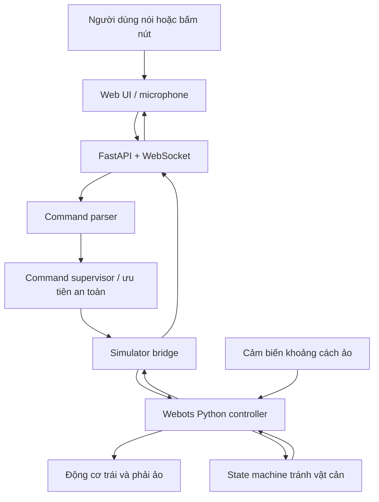
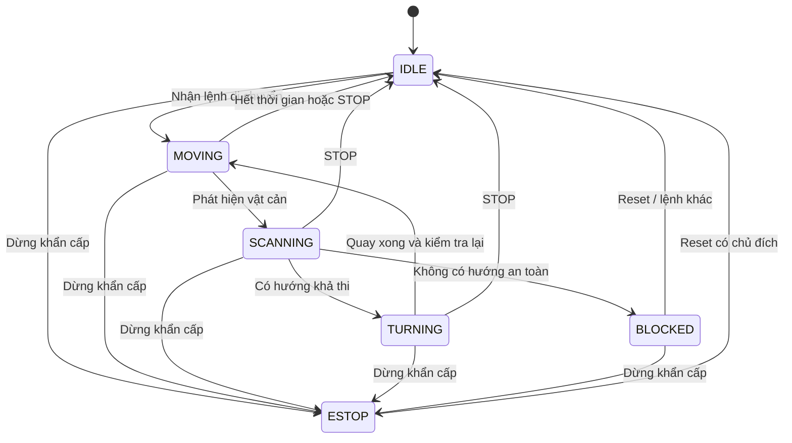

# Kế hoạch xây dựng Voice-Controlled Autonomous Robot (Simulation First)

> **Phiên bản:** 1.0  
> **Ngày lập:** 13/10/2026  
> **Đối tượng:** Người mới học robotics, đã biết Python cơ bản  
> **Chiến lược:** Làm phần mềm và mô phỏng trước, chỉ mua phần cứng sau khi MVP hoạt động.  
> **Thời lượng mục tiêu:** 14 ngày học và thực hành (có thể kéo dài 3–6 tuần).  
> **Môi trường tham chiếu:** Ubuntu 22.04/24.04, Python 3.10+; có thể thực hiện trên Windows 11. Với Webots nên chạy bản desktop native thay vì WSL khi mới bắt đầu.

---

## 0. Mục tiêu và phạm vi

### 0.1. Đầu ra cuối cùng của giai đoạn mô phỏng

Người dùng nói **"đi thẳng"** vào micro. Hệ thống chuyển lời nói thành văn bản, chuyển thành lệnh có cấu trúc, truyền đến bộ điều khiển robot mô phỏng. Robot di chuyển tiến, phát hiện vật cản, dừng và thử chọn hướng an toàn để đi tiếp; nếu không có đường thì đứng yên. Một giao diện web hiển thị trạng thái, khoảng cách, lệnh đang chạy và có nút dừng khẩn cấp.

**Tiêu chí MVP:**

- [ ] Khởi động một thế giới Webots có robot hai bánh vi sai (khuyên dùng e-puck có sẵn).
- [ ] Điều khiển tiến, lùi, quay trái, quay phải, dừng bằng Python.
- [ ] Đọc được dữ liệu cảm biến khoảng cách trong Webots.
- [ ] Tự tránh vật cản với state machine mà không cần AI/Internet.
- [ ] Chạy một API/server riêng, điều khiển robot qua giao thức thông điệp định nghĩa rõ ràng.
- [ ] Có giao diện web với điều khiển thủ công và nút STOP.
- [ ] Nhận ít nhất 5 lệnh giọng nói tiếng Việt, có cơ chế xác nhận lệnh và xử lý trường hợp không hiểu.
- [ ] Robot dừng khi mất lệnh điều khiển theo timeout trong chế độ thủ công.
- [ ] Có log và các bài kiểm thử cho bộ phân tích lệnh, điều khiển và tránh vật cản.

### 0.2. Không làm ở MVP

- Không cần ROS 2, SLAM, navigation stack, LLM, reinforcement learning.
- Không cần YOLO ngay ở giai đoạn đầu: cảm biến khoảng cách mô phỏng đủ để học điều khiển và né vật cản.
- Không yêu cầu robot tự định vị trên bản đồ hoặc đến một mục tiêu tùy ý.
- Không coi việc né vật cản bằng 3 hướng đo là đảm bảo an toàn tuyệt đối.
- Chưa mua ESP32, pin, driver hay camera.

### 0.3. Kiến thức cần nắm sau dự án

1. Robot hai bánh vi sai và tốc độ bánh trái/phải.
2. Sensor → Decision → Actuator và vòng lặp điều khiển.
3. State machine, ưu tiên an toàn, timeout và chuyển trạng thái.
4. Giao tiếp giữa backend với chương trình điều khiển robot.
5. Speech-to-text (STT), intent parsing và kiểm thử.
6. Thiết kế để thay phần mô phỏng bằng firmware ESP32.

---

## 1. Kiến trúc tổng quan



**Nguyên tắc quan trọng:** Thuật toán tránh vật cản và dừng khi nguy hiểm chạy **ngay trong controller của robot**; STT và server chỉ gửi yêu cầu cấp cao. Nếu server hoặc Wi-Fi lỗi, tầng điều khiển phải có cách dừng an toàn.

### 1.1. Hợp đồng lệnh đề xuất

Ví dụ dạng JSON (trên server), có `command_id` để truy vết:

```json
{
  "command_id": "cmd-0001",
  "type": "MOVE_FORWARD",
  "speed": 0.3,
  "duration_ms": 1500,
  "mode": "MANUAL"
}
```

Các lệnh ban đầu:

| `type` | Ý nghĩa | Ghi chú |
|---|---|---|
| `MOVE_FORWARD` | Đi thẳng | Mặc định có giới hạn thời gian, không chạy vô hạn |
| `MOVE_BACKWARD` | Lùi | Tốc độ thấp, kiểm tra phía sau nếu có cảm biến |
| `TURN_LEFT` | Quay trái | Dùng tốc độ và thời lượng ban đầu |
| `TURN_RIGHT` | Quay phải | Tương tự |
| `STOP` | Dừng ngay | Ưu tiên cao nhất |
| `SET_MODE` | Chọn `MANUAL` hoặc `AUTO_AVOID` | Chuyển chế độ cần rõ ràng |

**Lưu ý:** `speed: 0.3` là mức điều khiển chuẩn hóa 0–1, **không phải m/s**; lớp adapter sẽ chuyển thành vận tốc bánh trong giới hạn robot. `duration_ms` chỉ là một giới hạn thời gian, không đảm bảo quãng đường/góc quay chính xác.

### 1.2. Trạng thái điều khiển



`ESTOP` phải luôn có ưu tiên so với các lệnh thông thường. Tránh dùng `sleep()` dài làm chặn xử lý STOP; sử dụng vòng lặp cập nhật ngắn.

---

## 2. Công cụ, cài đặt và xác minh môi trường

### 2.1. Công cụ cần dùng

- **Webots:** mô phỏng robot, động cơ, cảm biến, môi trường vật lý. Tài liệu: <https://cyberbotics.com/doc/guide/index>.
- **Python 3.10+:** controller, server và test.
- **FastAPI + Uvicorn:** web API.
- **WebSocket:** gửi lệnh và telemetry hai chiều.
- **pytest:** kiểm thử phần mềm.
- **Git:** quản lý phiên bản.
- **STT:** bắt đầu từ nhập văn bản giả lập, sau đó dùng `faster-whisper` hoặc lựa chọn khác; xử lý microphone trong browser hoặc Python.
- **HTML/JS:** dashboard đơn giản trước khi dùng React/Vue.

### 2.2. Thiết lập dự án

```bash
mkdir voice-controlled-robot
cd voice-controlled-robot
git init
python3 -m venv .venv
source .venv/bin/activate  # Windows PowerShell: .venv\Scripts\Activate.ps1
python -m pip install --upgrade pip
pip install fastapi 'uvicorn[standard]' websockets pytest pydantic
```

Tạo `.gitignore`:

```gitignore
.venv/
__pycache__/
.pytest_cache/
*.pyc
.env
logs/
```

Cài Webots từ trang chính thức: <https://cyberbotics.com/>. Mở phần Examples/robot examples, tìm ví dụ e-puck và chạy **một thế giới mẫu chưa chỉnh sửa** để xác nhận phần mềm hiển thị được robot và hoạt động.

**Kiểm tra trước khi code:**

- [ ] `python --version` cho biết phiên bản Python được hỗ trợ.
- [ ] `pytest --version` chạy được.
- [ ] Webots mở được mô phỏng và có thể bấm Run/Pause.
- [ ] Tạo commit đầu tiên: `chore: initialize simulation-first robot project`.

> Ghi chú về phiên bản: Tên world, controller, node hoặc API Webots có thể khác theo bản đang cài. Xem controller mẫu và tên thiết bị thực tế trong scene tree, **không đoán** tên motor/cảm biến. Ghi lại phiên bản Webots vào README.

---

## 3. Cấu trúc repo dự kiến

```text
voice-controlled-robot/
├── README.md
├── docs/
│   ├── architecture.md
│   ├── command-protocol.md
│   ├── test-plan.md
│   └── learning-notes.md
├── simulator/
│   ├── worlds/                    # Tệp .wbt: world với vật cản
│   ├── controllers/
│   │   └── robot_controller/      # Entry point chạy trong Webots
│   └── bridge/                   # Socket/IPC adapter giao tiếp server
├── robot/
│   ├── interfaces.py             # Định nghĩa interface trừu tượng
│   ├── kinematics.py             # Tốc độ bánh trái/phải
│   ├── states.py                 # Enum và chuyển trạng thái
│   ├── obstacle_avoidance.py     # Logic ra quyết định, độc lập Webots
│   ├── supervisor.py             # Arbitration: STOP > safety > movement
│   └── types.py                  # Command, Telemetry
├── ai/
│   ├── command_parser.py         # Text -> lệnh có cấu trúc
│   └── speech_to_text.py         # Audio -> text
├── server/
│   └── main.py                   # FastAPI/WebSocket
├── web/
│   ├── index.html
│   └── app.js
├── tests/
│   ├── test_command_parser.py
│   ├── test_obstacle_avoidance.py
│   ├── test_supervisor.py
│   └── test_protocol.py
├── requirements.txt
└── .gitignore
```

**Giải thích:** Tầng `robot/` không được `import` Webots. Chỉ `simulator/` biết API Webots; sau này `hardware/` sẽ biết ESP32. Thiết kế này cho phép unit test bằng Python mà không mở simulator.

---

## 4. Lịch 14 ngày: công việc, bài thực hành và nghiệm thu

### Ngày 1 — Làm quen với simulator và chạy ví dụ có sẵn

**Mục tiêu:** Thấy một robot hoạt động trong Webots.

1. Cài Webots; ghi lại version, OS, kiến trúc CPU.
2. Mở một ví dụ e-puck từ Examples.
3. Bấm chạy, tạm dừng, reset mô phỏng; quan sát scene tree.
4. Xác định các node: robot, bánh xe/motor, cảm biến, vật cản.
5. Tạo `docs/learning-notes.md`; ghi 5 quan sát và 3 câu hỏi chưa hiểu.
6. Chụp screenshot robot (lưu trong `docs/assets/` nếu muốn).

**Nghiệm thu:** Robot mẫu chạy mà không phát sinh lỗi ảnh hưởng tới mô phỏng. Có commit `docs: explore webots example`.

### Ngày 2 — Viết controller Python tối thiểu

**Mục tiêu:** Hiểu vòng lặp điều khiển trong Webots.

1. Tạo bản sao world mẫu; không sửa world gốc.
2. Gắn Python controller do bạn viết vào robot, hoặc chỉnh controller của bản sao.
3. Dùng API `Robot`, `getDevice()`, `getBasicTimeStep()`, `step()` theo tài liệu phiên bản đã cài.
4. Liệt kê đúng tên các motor, thử thiết lập chế độ velocity và đặt vận tốc thấp.
5. Chạy robot tiến trong khoảng mô phỏng ngắn, sau đó dừng.
6. Thử dừng mô phỏng ở mọi thời điểm; không để robot chạy vô hạn khi test.

**Nghiệm thu:** Có video hoặc screenshot chứng minh điều khiển từ Python thành công.

### Ngày 3 — Chuyển động vi sai (differential drive)

**Mục tiêu:** Điều khiển riêng bánh trái/bánh phải.

1. Viết API `set_wheel_speeds(left, right)`.
2. Khai báo giới hạn vận tốc từ thông số motor mô phỏng; clamp mọi giá trị.
3. Thử 5 trường hợp: tiến, lùi, xoay trái tại chỗ, xoay phải tại chỗ, dừng.
4. Ghi log tốc độ yêu cầu và tốc độ thực tế (nếu đọc được).
5. Tìm hiểu `v = r(ωR+ωL)/2` và `ω = r(ωR−ωL)/L`, với `r` là bán kính bánh và `L` là khoảng cách hai bánh.

**Nghiệm thu:** Mỗi chuyển động có bài test thủ công và kết quả kỳ vọng.

### Ngày 4 — Tách business logic và command parser

**Mục tiêu:** Điều khiển bằng các command chuẩn hóa, không gắn chặt vào Webots.

1. Tạo `robot/types.py` với `Command`, `Telemetry`, `RobotMode`.
2. Tạo `robot/interfaces.py` với abstract methods `set_wheel_speeds`, `read_distances`, `stop`.
3. Viết `ai/command_parser.py` ánh xạ:
   - `đi thẳng`, `tiến lên` → `MOVE_FORWARD`;
   - `lùi lại` → `MOVE_BACKWARD`;
   - `rẽ trái` → `TURN_LEFT`;
   - `rẽ phải` → `TURN_RIGHT`;
   - `dừng lại`, `đứng yên` → `STOP`.
4. Văn bản không hiểu → `UNKNOWN`; **không** mặc định tiến lên.
5. Viết pytest cho ít nhất 10 trường hợp (bao gồm chữ hoa, dấu câu, khoảng trắng, lệnh không hợp lệ).

**Nghiệm thu:** `pytest tests/test_command_parser.py` chạy thành công.

### Ngày 5 — Đọc cảm biến và lọc dữ liệu

**Mục tiêu:** Phân biệt khoảng trống, gần vật cản và dữ liệu không đáng tin.

1. Xác định loại cảm biến trên e-puck mẫu (thường là proximity sensors); đọc đúng tài liệu thiết bị.
2. **Không coi output của sensor là centimet nếu chưa hiệu chuẩn.** Có thể bắt đầu từ ngưỡng giá trị cảm biến theo mẫu và test từng khoảng cách.
3. Log giá trị từng cảm biến khi robot tiến gần một bức tường.
4. Gom cảm biến thành nhóm front/left/right theo vị trí thực tế.
5. Xử lý NaN/giá trị sai/không có dữ liệu theo cách an toàn: dừng hoặc giảm tốc.
6. Nếu muốn dùng khoảng cách đo theo mét, cân nhắc thêm `DistanceSensor` được cấu hình/hiệu chuẩn rõ ràng hoặc dùng ray-based sensor trong simulator; không tự giả định `distance_cm` từ raw proximity value.

**Nghiệm thu:** Log thể hiện sự thay đổi đo được khi vật cản tiến gần.

### Ngày 6 — State machine tránh vật cản v1

**Mục tiêu:** Tự dừng trước vật cản.

1. Định nghĩa `IDLE`, `MOVING`, `SCANNING`, `TURNING`, `BLOCKED`, `ESTOP`.
2. Tách hàm thuần `next_state(current_state, sensor_snapshot, command, time)`.
3. Cài ngưỡng cảnh báo/dừng theo **đơn vị và kết quả hiệu chuẩn thật của cảm biến mô phỏng**.
4. Hysteresis: một ngưỡng để dừng và một ngưỡng thoáng hơn để tiếp tục, tránh rung trạng thái.
5. Ưu tiên STOP/ESTOP trước mọi chuyển động.
6. Viết ít nhất 6 unit test: không có vật cản, gần vật cản, cảm biến hỏng, STOP, blocked, nhấp nháy qua ngưỡng.

**Nghiệm thu:** Robot dừng được ở trước tường trong world có vật cản, không va chạm trong các ca thử đã định.

### Ngày 7 — Né vật cản v2: chọn trái/phải

**Mục tiêu:** Robot tự chọn một hướng rẽ khả thi.

1. Dùng dữ liệu cảm biến trái/phải; nếu không đủ dữ liệu thì thêm hành vi quét bằng quay robot tại chỗ rồi đo lại.
2. Luồng: `MOVING → STOP → SCANNING → TURNING → MOVING`.
3. Chỉ rẽ khi hướng đủ thoáng; kiểm tra lại ngay sau rẽ.
4. Đặt giới hạn số lần thử, thời gian quay và thời gian kẹt; sau N lần thất bại → `BLOCKED`.
5. Kiểm tra 3 scene: chỉ thoáng trái, chỉ thoáng phải, bị chặn cả hai.
6. Ghi state transition và nguyên nhân quyết định vào log.

**Nghiệm thu:** Robot tránh được vật cản trong 2 world đơn giản; trong world bế tắc phải dừng (không quay vô hạn).

### Ngày 8 — Thiết kế protocol và simulator bridge

**Mục tiêu:** Điều khiển robot từ bên ngoài Webots.

1. Viết `docs/command-protocol.md`: schema lệnh, schema telemetry, đơn vị, lỗi.
2. Chọn phương thức IPC đơn giản nhất cho môi trường cục bộ: TCP socket hoặc WebSocket; Webots controller và server là **hai tiến trình** riêng.
3. Bắt đầu với message JSON một dòng, có dấu xuống dòng, hoặc WebSocket; không gửi JSON tùy ý nối sát nhau trên TCP.
4. Định nghĩa `command_id`, `timestamp`, `type`, `speed`, `duration_ms`, `mode` và phản hồi `accepted/rejected`.
5. Nếu chưa nối được Webots với server, dùng `FakeRobotAdapter` in lệnh ra console trước.
6. Cần cơ chế queue/thread hoặc non-blocking I/O để không khóa vòng `robot.step()`.

**Nghiệm thu:** Script Python bên ngoài gửi `STOP`, controller nhận và dừng. Sau đó thử `MOVE_FORWARD` với giới hạn thời gian.

### Ngày 9 — FastAPI và WebSocket

**Mục tiêu:** Có API điều khiển và telemetry.

1. Tạo `server/main.py` và endpoint `GET /health`.
2. Tạo `POST /commands` (test ban đầu) và `/ws/telemetry` để stream trạng thái.
3. Dùng Pydantic validate enum, tốc độ 0–1, duration max và mode hợp lệ.
4. Luôn xác nhận lại quyền điều khiển trước khi đưa lệnh tới robot.
5. Log các lỗi: invalid command, timeout, disconnect.
6. Mặc định server bind `127.0.0.1` trong giai đoạn học; không mở ra Internet nếu chưa có authentication.

**Nghiệm thu:** Gửi lệnh bằng curl hoặc script, đọc được status robot qua API.

### Ngày 10 — Web dashboard và điều khiển thủ công

**Mục tiêu:** Điều khiển robot từ trình duyệt.

1. Giao diện có nút Forward/Backward/Left/Right/STOP.
2. Hiển thị `mode`, `state`, `last_command`, sensor values, connection status.
3. Không auto-repeat di chuyển nếu chỉ bấm một lần; dùng lệnh có duration giới hạn hoặc dead-man control (nhấn giữ để đi).
4. Khi nhả nút, mất focus, đóng tab hoặc mất kết nối, gửi STOP khi có thể và dựa thêm vào timeout của robot.
5. Nút STOP rõ ràng, hoạt động trong mọi mode.

**Nghiệm thu:** Điều khiển đầy đủ bằng UI và test rút kết nối mạng mô phỏng.

### Ngày 11 — Giọng nói: prototype STT độc lập

**Mục tiêu:** Chuyển tiếng Việt nói thành text.

1. Ghi âm 5 câu lệnh bằng microphone máy tính.
2. Có thể dùng `faster-whisper` offline; tải model phù hợp tài nguyên và lưu ý lần đầu có thể cần Internet.
3. Viết `ai/speech_to_text.py` nhận audio file và trả transcript; không ghép API robot ở bước này.
4. Chuẩn hóa khoảng trắng/chữ hoa và đánh giá lệnh sai do ASR.
5. Với transcript mơ hồ, không tự thực thi chuyển động. Nên hiển thị text và yêu cầu nói lại/xác nhận.
6. Chỉ sau khi file audio hoạt động ổn định mới thử microphone streaming.

**Nghiệm thu:** 5 lệnh mẫu cho ra transcript đủ chính xác để parser nhận diện; log cả trường hợp thất bại.

### Ngày 12 — Kết nối giọng nói vào hệ thống

**Mục tiêu:** Nói → nhận dạng → gửi lệnh → robot thực hiện.

1. Xây pipeline `audio → STT → parser → validation → supervisor → robot`.
2. Các lệnh di chuyển mặc định có thời lượng ngắn; nút STOP vật lý chưa có nên STOP trên web luôn phải sử dụng được.
3. Thêm `cancel` để lệnh mới có thể hủy lệnh di chuyển trước.
4. Test ít nhất 10 lần mỗi câu trong điều kiện phòng yên tĩnh.
5. Test trường hợp micro không có quyền truy cập, audio quá nhỏ, STT không trả kết quả.

**Nghiệm thu:** Có thể nói "đi thẳng", "rẽ trái", "rẽ phải", "dừng lại" trong bản mô phỏng và quan sát được hành động đúng; không di chuyển khi lệnh bị nhận nhầm/không hiểu.

### Ngày 13 — Kiểm thử hệ thống và chống lỗi

**Mục tiêu:** Ổn định trước demo.

Kiểm thử các tình huống:

- [ ] STOP trong lúc tiến.
- [ ] STOP ngay khi đang rẽ tránh vật cản.
- [ ] Mất WebSocket khi robot đang chạy.
- [ ] Server restart trong khi Webots vẫn mở.
- [ ] Sensor trả dữ liệu bất thường.
- [ ] Gửi hai lệnh mâu thuẫn liên tiếp.
- [ ] Gửi tốc độ âm, quá 1, duration quá giới hạn, JSON thiếu trường.
- [ ] Robot bị kẹt giữa các chướng ngại vật.
- [ ] STT trả chuỗi không được hỗ trợ.
- [ ] Chạy liên tục ít nhất 10–15 phút trong mô phỏng để quan sát lỗi trạng thái.

**Nghiệm thu:** Lưu `docs/test-plan.md` với test case, kỳ vọng, kết quả pass/fail, bằng chứng.

### Ngày 14 — Demo, đóng gói, đánh giá và lập backlog

**Mục tiêu:** Một người khác có thể chạy lại dự án.

1. Viết README: yêu cầu, cài đặt, chạy simulator, chạy server, mở UI.
2. Ghi bản Webots, bản Python, cách cấu hình port, tên world, controller.
3. Demo: giọng nói → robot chạy → gặp vật cản → chọn hướng → dừng khi cần.
4. Quay video demo ngắn.
5. Tổng hợp các lỗi còn lại và ý tưởng phát triển.
6. Tag Git `v0.1.0-simulation-mvp` nếu tất cả tiêu chí đạt.

**Nghiệm thu:** Clone repo trên môi trường mới, làm theo README và chạy được demo mà không phụ thuộc vào các file bí mật trên máy tác giả.

---

## 5. Hướng dẫn thuật toán tránh vật cản

### 5.1. Luật ưu tiên

1. `ESTOP` (dừng khẩn cấp đã chốt) và `STOP`.
2. Dữ liệu cảm biến bất thường / khoảng cách không an toàn.
3. Chế độ tránh vật cản đang thực thi.
4. Lệnh điều khiển thông thường.

### 5.2. Pseudocode ban đầu

```python
# Giả mã để học logic, không phải controller hoàn chỉnh.
def update(robot, state, command, sensors, now):
    if command.type in {"STOP", "ESTOP"}:
        robot.stop()
        return "ESTOP" if command.type == "ESTOP" else "IDLE"

    if not sensors.valid:
        robot.stop()
        return "BLOCKED"

    if sensors.front_too_close:
        robot.stop()
        return "SCANNING"

    if state == "SCANNING":
        if sensors.left_is_clear and sensors.left_clearance > sensors.right_clearance:
            robot.start_turn_left_limited(now)
            return "TURNING"
        if sensors.right_is_clear:
            robot.start_turn_right_limited(now)
            return "TURNING"
        robot.stop()
        return "BLOCKED"

    # Các trạng thái khác do state machine xử lý.
    return state
```

**Quan trọng:** Mẫu trên chỉ minh họa; với cảm biến quét bằng cách quay xe, `SCANNING` phải gồm nhiều bước không chặn: quay một góc → đọc → quay hướng còn lại → đọc → quyết định. Không nên đưa độ đo chưa hiệu chuẩn vào thuật toán.

### 5.3. Vòng lặp điều khiển

- Lấy timestep từ Webots, không giả định máy chạy đúng 20/30/60 FPS.
- Tại mỗi step: đọc sensor → xử lý lệnh mới → safety check → cập nhật state → xuất tốc độ bánh → tạo telemetry.
- Không dùng xử lý STT hoặc gọi HTTP đồng bộ trong vòng điều khiển, vì có thể khiến robot không kịp dừng.

---

## 6. Kiểm thử: bảng tình huống bắt buộc

| Mã | Tình huống | Kết quả kỳ vọng |
|---|---|---|
| T01 | Có lệnh đi thẳng, không vật cản | Tiến đến khi hết thời lượng hoặc có lệnh mới |
| T02 | Có vật cản ngay phía trước | Dừng trước khi va chạm ở tốc độ đã test |
| T03 | Trái trống, phải chặn | Chọn trái |
| T04 | Phải trống, trái chặn | Chọn phải |
| T05 | Cả hai hướng bị chặn | `BLOCKED`, vận tốc bánh bằng 0 |
| T06 | Đang quay, nhận STOP | Dừng ở chu kỳ điều khiển gần nhất |
| T07 | Mất điều khiển trong MANUAL | Timeout và dừng |
| T08 | Cảm biến invalid | Dừng / `BLOCKED` |
| T09 | Speech parser nhận text rác | `UNKNOWN`, không di chuyển |
| T10 | Command tốc độ > 1 | API từ chối |
| T11 | Hai lệnh liên tiếp nhanh | Thực hiện theo arbitration đã công bố |
| T12 | Restart server | Controller về trạng thái an toàn theo chính sách |

**Chỉ số nên theo dõi:** số lần va chạm trong world test, tỷ lệ chọn hướng đúng theo kịch bản, độ trễ lệnh → hành động, thời gian xử lý STOP, số lần bị `BLOCKED` sai, độ chính xác phân tích lệnh giọng nói.

Không đặt cam kết mili-giây khi chưa đo được trên máy thực tế.

---

## 7. Các mốc Git và định nghĩa hoàn thành

| Mốc | Nội dung | Commit gợi ý |
|---|---|---|
| M1 | World Webots + controller điều khiển bánh | `feat: basic differential-drive simulator` |
| M2 | Sensor + obstacle avoidance + tests | `feat: safe obstacle avoidance state machine` |
| M3 | Protocol + server + dashboard | `feat: remote simulation control` |
| M4 | STT + parser + integration tests | `feat: vietnamese voice commands` |
| M5 | README + reproducible demo | `docs: release simulation mvp` |

Mỗi mốc chỉ đánh dấu hoàn thành khi có: **chạy được, test được, log đọc được, commit được**.

---

## 8. Lộ trình sau MVP (tùy chọn, không làm đồng thời)

### 8.1. Tuần nâng cao 1: Xử lý hình ảnh

- Dùng webcam máy tính để làm quen OpenCV (`VideoCapture`, resize, annotate, latency).
- Chạy model nhận diện vật thể lightweight bằng YOLO trên video file/webcam.
- Nếu cần camera trên robot mô phỏng, thêm **Camera node** trong Webots, bật camera rồi truyền frame ra pipeline xử lý; chú ý chi phí truyền frame.
- Chỉ dùng vision để hỗ trợ thông tin; vẫn ưu tiên cảm biến khoảng cách trong stop logic.

### 8.2. Tuần nâng cao 2: Vận tốc, encoder, PID

- Mô phỏng wheel encoder/position sensors tương ứng với robot đang dùng.
- Tính vận tốc hai bánh, ước lượng odometry; kiểm tra drift.
- Viết PID giữ vận tốc, so sánh với điều khiển open-loop.
- Nếu muốn quay góc nhất định, dùng feedback thay vì chỉ đặt thời gian.

### 8.3. Tuần nâng cao 3: ROS 2 (chỉ nếu cần)

- Học node/topic/service/action, `cmd_vel`, sensor messages.
- Thiết kế adapter để xuất command và telemetry theo ROS 2.
- Chuyển sang navigation/SLAM chỉ sau khi hiểu frame, odometry và sensor noise.

### 8.4. Chuyển sang phần cứng

**Bản mua tối thiểu đề xuất:** chassis 2WD, 2 motor DC có encoder, driver TB6612FNG (kiểm tra dòng stall), ESP32 DevKit, cảm biến khoảng cách, nguồn phù hợp; ESP32-CAM có thể bổ sung sau.

Các bước chuyển đổi:

1. Giữ nguyên `robot/` và `ai/`.
2. Tạo `hardware/esp32_firmware/` và `hardware/esp32_adapter.py`.
3. Adapter gửi đúng schema command hiện có qua Wi-Fi; ESP32 trả telemetry.
4. ESP32 phải tự đảm nhiệm safety, watchdog, timeout; không phụ thuộc vào laptop để dừng.
5. Test từng thành phần ở tốc độ thấp, kê bánh khỏi mặt bàn khi test lần đầu.
6. Sau khi chạy ổn mới lắp camera và streaming.

**Điện và an toàn:** Không cấp động cơ trực tiếp từ GPIO. Chú ý dòng khởi động/stall, GND chung, chống sụt áp, bảo vệ pin. Đối với pin Li-ion, sử dụng cell, BMS và bộ sạc đúng cấu hình; không tự chế bộ pin nối tiếp khi chưa có kiến thức an toàn. HC-SR04 loại 5V thường cần chuyển mức ở chân ECHO khi kết nối với ESP32 3,3V.

---

## 9. Những lỗi người mới thường gặp

| Lỗi | Hậu quả | Cách tránh |
|---|---|---|
| Dùng `time.sleep()` dài trong controller | Bỏ lỡ STOP/sensor event | State machine + Webots timestep |
| Coi giá trị proximity sensor là cm | Sai ngưỡng an toàn | Đọc docs, hiệu chuẩn sensor |
| Chạy AI trong vòng điều khiển | Độ trễ không ổn định | Tách AI/server khỏi control loop |
| Lệnh “đi thẳng” chạy mãi | Robot khó kiểm soát | Timeout hoặc dead-man switch |
| Truyền JSON qua TCP không framing | Lỗi parse dữ liệu | Newline-delimited JSON hoặc WebSocket |
| Không lưu log | Khó tìm lỗi | Log command, sensor, state, error |
| Trộn `Webots` và logic nghiệp vụ | Khó tái sử dụng trên ESP32 | `RobotInterface` và adapter |
| Mua phần cứng quá sớm | Tốn tiền, khó debug | Hoàn thành M1–M3 trước |

---

## 10. Checklist mỗi buổi học

```markdown
### Nhật ký — YYYY-MM-DD

**Mục tiêu hôm nay:**

**Đã làm:**
- [ ]

**Đã kiểm thử:**
- [ ]

**Lỗi gặp phải:**
- Lỗi / nguyên nhân / cách sửa:

**Kiến thức mới:**
-

**Commit Git:**
-

**Việc ngày tiếp theo:**
-
```

---

## 11. Backlog phiên bản 0.2 / 0.3

- [ ] Hỗ trợ câu nói "đi thẳng 2 giây", "rẽ trái 90 độ" (góc quay chính xác cần feedback).
- [ ] Hiển thị robot pose 2D và vệt đường đi.
- [ ] Đồ thị khoảng cách cảm biến theo thời gian.
- [ ] Tự động phát hiện robot bị kẹt (motor command có nhưng pose không thay đổi).
- [ ] Thiết kế command acknowledgement, sequence number, timeout và replay protection.
- [ ] Video stream trong dashboard.
- [ ] Command history và nút hủy lệnh.
- [ ] Thử nhiều world, nhiều điều kiện cảm biến và tốc độ.
- [ ] Chuyển từ mô phỏng sang ESP32.

---

## 12. Tài liệu tham khảo

1. Webots chính thức: <https://cyberbotics.com/>
2. Webots User Guide: <https://cyberbotics.com/doc/guide/index>
3. Webots Reference Manual: <https://cyberbotics.com/doc/reference/index>
4. Webots tutorials: <https://cyberbotics.com/doc/guide/tutorials>
5. FastAPI: <https://fastapi.tiangolo.com/>
6. FastAPI WebSocket: <https://fastapi.tiangolo.com/advanced/websockets/>
7. pytest: <https://docs.pytest.org/>
8. faster-whisper: <https://github.com/SYSTRAN/faster-whisper>
9. ESP-IDF (giai đoạn sau): <https://docs.espressif.com/projects/esp-idf/en/stable/esp32/>

---

## Bắt đầu ngay: 3 việc đầu tiên

1. Tạo repository và cài Webots, Python environment.
2. Chạy e-puck example có sẵn, ghi đúng tên thiết bị và phiên bản Webots.
3. Tạo controller Python cho bánh trái/phải, chạy tiến 2 giây trong mô phỏng rồi dừng, lưu log và commit.

> **Nguyên tắc xuyên suốt:** Mỗi lần chỉ thêm một khả năng mới, kiểm thử nó trước khi chuyển bước tiếp theo. Ưu tiên robot dừng đúng và ổn định trước khi làm cho nó thông minh hơn.
